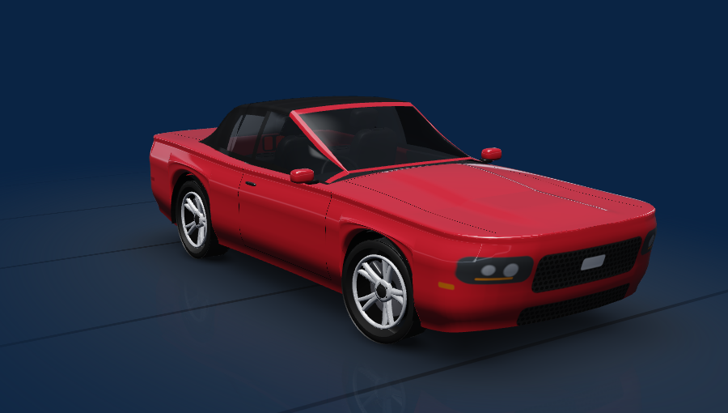
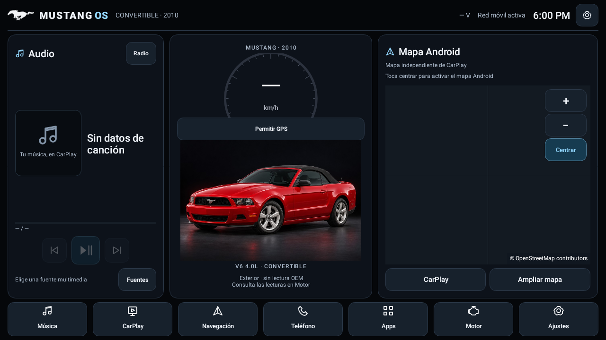

# MUSTANG OS · 0.8.1 · Render 3D y CarPlay

**Entrega 0.8.1:** el diagnóstico de la unidad confirmó música, 14 portadas y 149 tramas de ruta válidas. El mapa de Google Maps no puede incrustarse (ZLink no lo permite en Android 10) y la pantalla no tenía GPS en vivo; la guía de CarPlay ahora ocupa toda la tarjeta cuando no hay posición. [Hallazgos y cambios](docs/RELEASE_081.md).

**Entrega 0.8.0:** render OpenGL ES del Mustang con pintura de estudio, puertas, faros y rines animados; portada de CarPlay en JPEG/PNG con lectura continua y reconexión; guía giro a giro de CarPlay en la tarjeta Navegación; barra sobre CarPlay que se reduce sola para dejar ver el mapa; tablero rediseñado. El vídeo del mapa de CarPlay sigue en la ventana de ZLink (no incrustable en Android 10). [Cambios, causas y prueba en el coche](docs/RELEASE_080.md).



**Entrega 0.7.0:** el usuario confirmó canción y controles CarPlay. Se incorpora un modelo 3D estilizado con puertas asignables, faros, pintura y movimiento por velocidad real; lector PNG con asociación temporal limitada; solicitud optativa de telemetría RPM. Las funciones nuevas y la correspondencia de portada necesitan validación física. El mapa CarPlay dentro de una tarjeta continúa pendiente. [Configuración, prueba y límites](docs/RELEASE_070.md).

**Entrega 0.6.2:** lector experimental de campos musicales del canal local, compartido entre tarjeta y barra Mustang, con diagnóstico de campos sin contenidos privados. La muestra física 0.6.1 recibió 17 mensajes tipo 10; los valores de canción/tiempo todavía requieren validar la nueva APK en la unidad. Portada asociada y mapa del iPhone continúan pendientes. [Instalación y prueba](docs/RELEASE_062.md).

**Entrega 0.6.1:** investigación de capacidades y prueba manual de lectura del canal HUD identificado en ZLink, sin comandos ni cambios de configuración. El usuario confirmó la barra sobre CarPlay. La portada, música y ruta en tarjetas independientes continúan pendientes de recepción y contrato verificados. [Qué podemos integrar y cómo comprobarlo](docs/INVESTIGACION_ZLINK_20261028.md).

**Entrega 0.6.0:** CarPlay real con barra Mustang opcional, selector por familias con vista previa, pintura configurable, luces por señal OEM y diagnóstico GPS visible. Conserva el mapa de México. [Uso, permisos y límites](docs/RELEASE_060.md). La barra no extrae la portada ni la ruta del iPhone hacia las tarjetas.

**Entrega 0.5.0:** México completo offline dentro del panel, fondo Mustang común, radio propia, fotos automáticas por perfil y nuevas lecturas OEM. El mapa se descarga una vez aparte de la APK; incluye Jalisco, Colima y Michoacán. [Cambios e instalación del mapa](docs/RELEASE_050.md), [interfaces OEM adicionales](docs/OEM_APPS_20261028_ADDITIONAL.md). Los metadatos y la superficie CarPlay siguen pendientes de una interfaz compatible.

Launcher Android nativo para Ford Mustang con perfil personalizable. Incluye una imagen de referencia del Mustang 2010 V6 convertible rojo con capota negra. Cockpit azul medianoche inspirado en el Mustang reciente, con mapa Android dentro del panel, multimedia, datos OEM y aplicaciones. Kotlin, Views/XML y Canvas, pensado para 2 GB de RAM. Es software independiente, no una instalación de Ford SYNC.



La imagen anterior documenta la presentación 0.4.0. La 0.5.0 incorpora el fondo común, el catálogo y el mapa offline descritos en su nota de entrega.

La 0.4.0 añade mapa nativo con zoom, desplazamiento, centrado y pantalla completa; lectura de portadas de contenido local; búsqueda de aplicaciones; ajustes propios y presentación uniforme. Conserva los controles CarPlay confirmados por el usuario en 0.3.6, sin teclas globales ni cambios en ZLink. [Funciones, primer uso y límites de integración](docs/RELEASE_040.md).

Se conservan las modificaciones del usuario de 0.3.5 y las correcciones de [0.3.6](docs/UPDATE_036.md) y [0.3.7](docs/UPDATE_037.md). Los informes del equipo confirmaron SDK 29 pese a la etiqueta Android 13, voltaje OEM y recepción de aperturas. Temperatura, calidad GPS, metadatos de ZLink y ACC siguen requiriendo comprobación completa en la unidad.

**El mapa del panel es Android y usa la ubicación de la pantalla; no es la ruta del iPhone.** Desde 0.5.0 puede usar México vectorial sin conexión o el mapa online anterior. La superficie CarPlay sigue dependiendo de una interfaz de ZLink que aún no tenemos. Ampliar mapa conserva el mismo visor; CarPlay mantiene su acceso independiente. [Investigación](NATIVE_INTEGRATION.md).

**Motor** conserva lecturas con antigüedad y usa únicamente solicitudes fijas de lectura identificadas en el OEM para voltaje y temperatura. No modifica CANBUS, MCU o ZLink. [Datos que solicitar al proveedor para el mapa interno](docs/ZLINK_VENDOR_QUESTIONS.md).

## Instalar y empezar

**¿Vas a instalarlo en tu coche?** Sigue la [guía de instalación para usuarios](docs/GUIA_INSTALACION.md). Lo que sigue es la referencia técnica.

Para instalar **por enlace, sin memoria USB ni ADB**, sirve la APK desde un PC conectado a la misma red Wi-Fi. Se incluye `scripts/serve-apk.py`; consulta [la guía de descarga local](docs/LOCAL_DOWNLOAD.md). Abre su dirección en el navegador de la pantalla, descarga la APK y permite a ese navegador instalar aplicaciones cuando Android lo solicite. La autorización de instalación es independiente de las opciones de depuración protegidas por contraseña.

1. Con el coche estacionado, descarga y abre `MustangOS.apk` desde el enlace local. Instala sobre la versión anterior conservando los datos.

2. Abre Mustang OS como una aplicación normal. No cambia automáticamente el Home predeterminado.
3. En **Ajustes → Aplicaciones predeterminadas → Elegir launcher original**, selecciona la interfaz del fabricante. Prueba **Ajustes → Interfaz original** antes de elegir Mustang OS como Home.
4. Pulsa **CarPlay**. Se detecta el ZLink confirmado si está instalado; cuando hay varios candidatos se permite elegir. Se guarda el componente resuelto. No se instala, actualiza ni reinicia ZLink, ni se borran datos o activación.
5. Portada y Música abren CarPlay para la fuente del teléfono; una fuente Android elegida en **Fuentes** conserva su reproductor. Radio/teléfono detectan las apps OEM. **Ampliar mapa** muestra el mapa Android en pantalla completa; el dock Navegación permite abrir una app de rutas Android o CarPlay.
6. Pulsa el estado GPS para conceder ubicación **precisa**. El velocímetro pasa de `—` a una lectura real cuando el receptor entrega una velocidad válida. Sin señal o después de cinco segundos sin lectura válida vuelve a `—`.
7. En **Fuentes**, puedes autorizar acceso multimedia para descubrir MediaSessions. Los perfiles OEM conocidos sin capacidades declaradas admiten control estándar dirigido; las demás fuentes respetan sus acciones publicadas. Sin estado no se afirma pausa ni se inventa progreso. Los controles del iPhone fueron confirmados en 0.3.6; los metadatos dependen de la publicación de ZLink.
8. Para México completo abre **Ajustes → Mapas sin conexión** e importa el archivo descargado desde la página local. **Centrar** usa una posición GPS válida y conserva el mapa offline cuando está activo. El mapa por Internet sigue disponible como opción y solo solicita imágenes del área vista. Sin posición se puede explorar el mapa sin dibujar una ubicación ficticia.

La entrega usa `MustangOS.apk`, variante release con depuración desactivada, paquete `com.mustangos.launcher` y el mismo certificado local de las versiones anteriores para permitir la actualización. No se genera ni exporta una llave nueva. No se activa R8 en esta entrega para no introducir una transformación adicional en la integración OEM. La variante debug permanece disponible para desarrollo; ambas son independientes de ZLink.

## Volver al launcher original

- En Mustang OS: **Ajustes → Interfaz original**. Esto abre la aplicación elegida sin cambiar el Home.
- Para restaurarlo como predeterminado: **Ajustes → Aplicaciones predeterminadas → Elegir launcher predeterminado**, selecciona el del fabricante en Android. Algunos firmwares no ofrecen esta pantalla; también puedes acceder desde Ajustes Android → Apps → Apps predeterminadas → Inicio, si existe.
- Antes de cambiar Home, conserva acceso al panel de ajustes y prueba la restauración. Un firmware puede imponer su propia interfaz durante el arranque aunque Mustang OS sea Home.
- Si es necesario y ADB está autorizado: `adb shell am start -a android.settings.HOME_SETTINGS`. Para abrir una actividad original usa el componente que viste en el selector: `adb shell am start -n PAQUETE/ACTIVIDAD`. No sustituyas ese dato por un paquete supuesto.
- Desinstala **solo Mustang OS** desde Ajustes Android después de recuperar el launcher original. No ejecutes comandos de borrado sobre ZLink ni sobre componentes del fabricante.

## Qué incluye

| Función | Implementación | Validación pendiente |
|---|---|---|
| Dashboard 1280×720 y compacto | Views/XML/Canvas, grafito/azul hielo, iconos uniformes | Aspecto y densidad reales del T100 |
| Apps y teléfono | Selector PackageManager y actividad explícita guardada | Apps OEM concretas y permisos de cada firmware |
| Radio propia | Frecuencia/RDS y controles XT condicionados a radio activa | Datos, servicio y respuesta del sintonizador de la unidad |
| México offline | Mapsforge local, zoom, exploración y centrado GPS; paquete separado de 686 MiB | Importación y rendimiento en el equipo; sin rutas ni voz |
| CarPlay | Abre el ZLink elegido; conserva la tarea existente | Nueva presentación en la pantalla |
| Multimedia | MediaController, campos DISPLAY, bitmap y content URI acotada | Metadatos que ZLink publique durante CarPlay |
| Mapa del panel | OpenStreetMap real, zoom/pan/GPS y vista ampliada | Internet y posición de la pantalla |
| GPS | Ubicación precisa, filtro, caducidad y ciclo de vida visible | Calidad y frecuencia del GPS del coche |
| Diagnóstico | SDK, RAM, permisos, sesiones y componentes exportados | Capturar informe en pantalla real |
| Motor sin OBD | Lecturas OEM retenidas con antigüedad; datos Android separados | Canales/valores que publique la unidad |
| Ruta CarPlay dentro del panel | No integrada; mapa Android distinguido por origen | Contrato de superficie/ruta de ZLink |

La 0.5.0 añade el permiso normal `com.tw.carinfoservice.permission.USE_AIDL`, comprobado en el APK del equipo, para las lecturas de caché cuando la preferencia OEM está activa. Se añaden dependencias Mapsforge 0.30.0 (JitPack restringido al grupo del proyecto), con licencias y fuentes indicadas en los avisos del mapa. El paquete `.map` y los APK OEM no se incluyen en Git ni en la APK del launcher.

No se inventan temperaturas, kilometraje, rutas ni canciones. No se solicitan root, control de Bluetooth/Wi-Fi, accesibilidad, micrófono, contactos, audio focus ni permisos privilegiados. La 0.4.0 añade INTERNET para el mapa; su red empieza desactivada y las peticiones implican el área visible. No hay analítica ni servicio de GPS en segundo plano. El servicio de acceso multimedia no lee el contenido de las notificaciones.

La única autorización adicional de 0.3.0 es `zjinnova.android.permission.ZLINK_SERVICE`, confirmado como permiso **normal** en el equipo. La inspección comprueba propietario/nivel y lee únicamente el descriptor Binder de un servicio ya activo. No inicia ZLink ni invoca transacciones de aplicación desconocidas. Abre primero CarPlay, regresa y usa **Ajustes → Inspeccionar servicio ZLink**; luego exporta el informe si es necesario.

## Compilar

Abre la carpeta en Android Studio compatible con AGP 8.13.2, selecciona JDK 17 e instala SDK 35 / Build Tools 35.0.0. El wrapper usa Gradle 8.13 y Kotlin 2.2.21. `minSdk=26`, `targetSdk=35`. Puedes usar tu SDK existente con `local.properties`.

En este PC también se incluye un bootstrap reproducible para Windows que descarga herramientas oficiales dentro de `.tools/`, verifica sus sumas y acepta las licencias de SDK para el entorno local:

```powershell
.\scripts\bootstrap.ps1
.\scripts\verify.ps1
```

Sin bootstrap, con JDK 17 y SDK configurados:

```powershell
.\gradlew.bat :core:test :app:testDebugUnitTest :app:lintDebug :app:assembleDebug
```

El script verifica pruebas, lint y builds debug/release; copia las APK a `output/MustangOS-debug.apk` y `output/MustangOS.apk`. Los reportes se encuentran en `core/build/reports/tests/test`, `app/build/reports/tests/testDebugUnitTest` y `app/build/reports/lint-results-debug.html`. `output/` y las herramientas descargadas no forman parte del control de versiones.

## Organización

`core/` contiene las reglas Kotlin puras para selección multimedia, capacidades, progreso y filtro GPS; `app/` contiene `ui`, `settings`, `appintegration`, `carplay`, `media`, `navigation`, `gps`, `vehicle` y `diagnostics`. `LauncherViewModel` conecta las integraciones y su estado con la actividad. Los listeners y GPS se liberan al ocultarse la pantalla. El progreso visible se actualiza una vez por segundo sin enviar acciones al reproductor.

Lee [COMPATIBILITY.md](COMPATIBILITY.md), [ZLINK_INTEGRATION.md](ZLINK_INTEGRATION.md), [DEVICE_TEST_PLAN.md](DEVICE_TEST_PLAN.md) y [TEST_RESULTS.md](TEST_RESULTS.md) para distinguir evidencia automatizada de pruebas pendientes en el coche. El asset y su prompt están documentados en [docs/ASSETS.md](docs/ASSETS.md).
