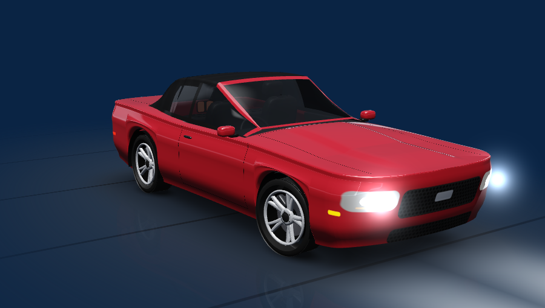
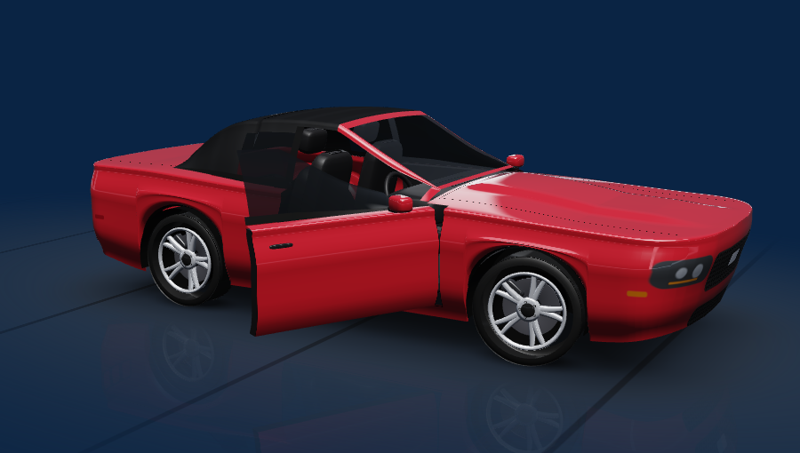
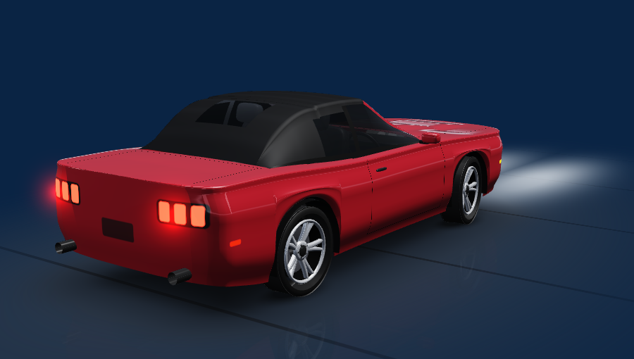

# Mustang OS 0.8.0 · Render 3D, portada y guía de CarPlay

Esta entrega atiende tres pedidos del usuario: la portada de CarPlay no llegaba aunque el título sí, el mapa de CarPlay no se aprovechaba desde el launcher y el modelo del coche se veía improvisado.

## Portada de CarPlay

Causas encontradas en el código de 0.7.0:

1. **Solo aceptaba PNG.** El iPhone envía normalmente las portadas en JPEG; cualquier imagen tipo 14 que no empezara por la firma PNG se ignoraba sin contarse. Ahora se aceptan JPEG, PNG, WebP y GIF, también si ZLink antepone una cabecera corta (se busca la firma en los primeros 64 bytes). La decodificación sigue acotada: máximo 4096 px por lado, 16 Mpx, y el bitmap final queda en 384 px.
2. **Ventana de 2 segundos.** En CarPlay inalámbrico la transferencia de la imagen tarda más que eso tras el anuncio de la canción. La ventana es ahora de 20 s, ligada a la canción actual; si llegan dos imágenes (la tardía de la canción saltada y la propia), gana la última.
3. **La lectura se detenía al salir del launcher.** El canal se cerraba 0,5 s después de ocultar Mustang OS, justo cuando ZLink pasaba al frente y enviaba la portada. Con «Datos de CarPlay» activo, la lectura continúa mientras ZLink está al frente y se reconecta sola (2 s, 5 s, 15 s, 30 s) si ZLink se reinicia o la sesión llega a su límite.
4. **Sesión estándar con título pero sin imagen.** Si la sesión multimedia de ZLink publica el título, ahora se toma la portada del canal cuando el título coincide.

Además se guardan en memoria las últimas 12 portadas por título/artista/álbum, para mostrar al instante una canción repetida aunque el iPhone no reenvíe la imagen. Nada se guarda en disco ni se busca en Internet.

El estado de reproducción iAP2 (1 reproduciendo, 2 en pausa, 3/4 avanzando) mueve ahora la barra de progreso y el icono de reproducción. Un estado desconocido sigue sin interpretarse.

## Mapa y guía de CarPlay

El vídeo del mapa de CarPlay lo dibuja ZLink en su propia ventana, que declara `resizeableActivity=false` y no permite imagen en imagen. Android 10 sin permisos de sistema no permite incrustar esa ventana dentro de una tarjeta. Por eso esta entrega hace dos cosas:

- **Guía giro a giro en la tarjeta Navegación.** Los tipos 8/9 del canal de ZLink usan el mismo formato iAP2 que ya funcionó para la música (`RouteGuidanceUpdate` / `RouteGuidanceManeuverUpdate`). Cuando el iPhone guía, la tarjeta muestra flecha de maniobra, distancia, instrucción y calle siguiente, hora de llegada, tiempo y distancia restantes. Solo se usan campos con el ancho esperado; los textos son los del iPhone. Tocar la guía abre el mapa de CarPlay.
- **CarPlay sin estorbos.** El botón principal de la tarjeta es «Mapa CarPlay». La barra Mustang sobre ZLink se reduce sola a un pequeño caballo en el borde derecho tras 6 s; tócalo para abrirla, arrástralo para moverlo y recuerda la posición.

Si la guía no aparece con una ruta activa, ZLink no está publicando los tipos 8/9 en esta unidad (su configuración trae `enable_hud: false`). El diagnóstico «Comprobar metadatos de ZLink» indica cuántas tramas de ruta llegaron y si se rechazaron.

## Render del coche

Se sustituye el modelo de polígonos planos por un render OpenGL ES 2.0 propio:

- Carrocería de superficies suaves generada por secciones con proporciones de cada familia (S197 con medidas publicadas: 4,78 m de largo, 2,72 m de batalla), pasos de rueda con forro interior, cofre con domo, techo de lona para convertible, cristal, interior con asientos y volante.
- Pintura con barniz, reflejos de estudio (softbox y tiras laterales), suelo con sombra de contacto y reflejo.
- Detalles por píxel: parrilla de panal, faros, calaveras tri-barra, juntas de puertas/cofre/cajuela, luces laterales.
- Rines de 10 rayos con disco y caliper (rojo en GT/Shelby/Dark Horse), neumáticos con perfil.
- Puertas animadas con panel interior; faros y calaveras encendidos con halo y luz en el suelo; ruedas que giran solo con velocidad válida; la cámara gira hacia la puerta abierta. Arrastra para girar el coche y doble toque para volver.
- Se dibuja solo cuando algo cambia y se pausa al abrir menús o salir. Si el equipo no ofrece OpenGL ES 2.0, se usa la fotografía del perfil.

El mismo render aparece en **Mi Mustang**. Sigue siendo una representación de la familia y la pintura elegidas, no un modelo CAD de cada edición.

| Puerta izquierda abierta | Vista trasera |
|---|---|
|  |  |

## Interfaz

- Tarjeta de audio con portada grande y fondo teñido con el color de la portada.
- Tarjeta del vehículo a sangre: render al centro, velocidad y RPM encima, estado OEM y GPS abajo.
- Tarjeta de navegación más ancha, con guía de CarPlay superpuesta al mapa y controles que se apartan cuando hay guía.
- Encabezado con chips de voltaje y red, reloj más grande.

## Probar en el coche

1. Instala sobre la versión anterior. En **Ajustes**, confirma que **Datos de CarPlay** está activo (viene activo por defecto en instalaciones nuevas; se respeta la elección previa).
2. Reproduce música en CarPlay y cambia de canción dos veces. La portada debería aparecer en la tarjeta en pocos segundos, también si ZLink estaba al frente.
3. Activa una ruta en Apple Maps o Google Maps del iPhone y vuelve a Mustang OS: la tarjeta Navegación debería mostrar la maniobra.
4. Si falta portada o guía, abre **Ajustes → Comprobar metadatos de ZLink** sin detener la lectura y exporta el diagnóstico. Indica imágenes recibidas, decodificadas, fuera de ventana, no reconocidas (con los 4 primeros bytes de la firma) y tramas de ruta válidas/rechazadas, sin canciones, imágenes ni direcciones.
5. Abre **Mi Mustang** y gira el coche con el dedo; abre una puerta para ver la animación.

La APK mantiene el certificado y los permisos de 0.7.0.
